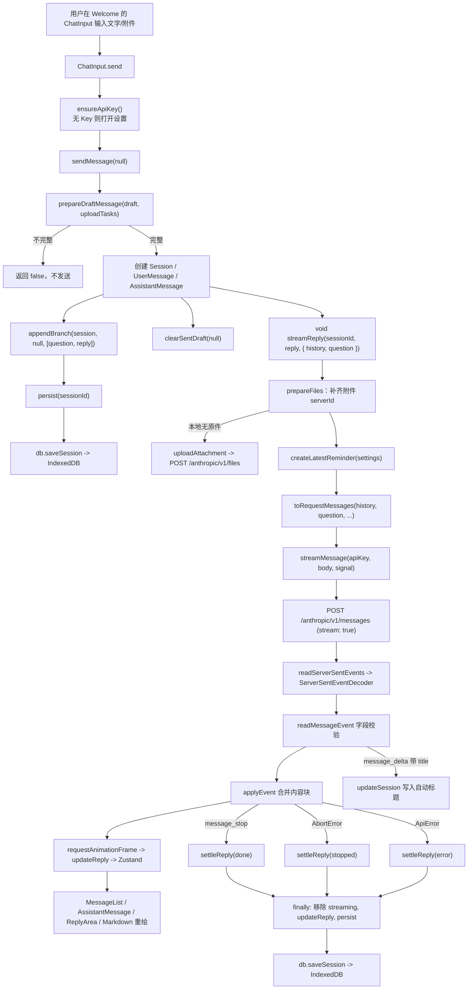

# chat-demo 代码结构说明

> 适用版本：`package.json` v0.1.1 ｜ 分支 `session` ｜ 基线提交 `7c7d20b` ｜ 最后更新：2026-11-20 ｜ 维护人：<待填>
>
> 相关链接：
>
> - 本仓库：<https://github.com/ChronoKnight-ZZH/deepseek-chat-demo>
> - 上游仓库：<https://github.com/deepseek-ai/chat-demo>
> - 使用说明：[README.zh-CN.md](../README.zh-CN.md)
> - 历史导入导出格式：[src/services/chat/history/README.md](../src/services/chat/history/README.md)
> - 部署流水线：[.github/workflows/pages.yml](../.github/workflows/pages.yml)

> 说明：本文只记录仓库中可验证的结构、导出符号和行为。无法仅凭仓库确认的内容会标注「待确认」。

---

## 1. 项目概览

### 一句话用途

`chat-demo` 是一个**无应用后端的静态聊天前端**：React 应用在浏览器中直接调用 DeepSeek 的 Anthropic 兼容 Messages / Files API，以及 ASR / TTS 接口；会话保存在浏览器 IndexedDB，设置与 API Key 保存在 localStorage。

### 技术栈与运行入口

| 项目     | 内容                                                                               |
| -------- | ---------------------------------------------------------------------------------- |
| 应用框架 | React 18.3.1 + TypeScript（`strict: true`）                                        |
| 状态管理 | Zustand 4.4.7                                                                      |
| 构建工具 | Rspack 2.0.2（`@rspack/cli`、`@rspack/core`、`builtin:swc-loader`、Lightning CSS） |
| 包管理   | pnpm（仓库含 `pnpm-lock.yaml`；CI 使用 pnpm 12.6.0）                               |
| 路由     | 浏览器 History API，真实路径 `/chat/<session id>`，无 React Router                 |
| 本地存储 | IndexedDB（`chat-demo` 库，会话与附件原件）+ localStorage（设置、登录记录）        |
| 渲染能力 | Markdown / GFM、Prism 代码高亮、KaTeX 公式、Mermaid 图表                           |
| 外部接口 | `https://api.deepseek.com`（可通过构建配置改 `apiOrigin`）                         |
| 运行入口 | `src/main.tsx` → `src/app/App.tsx`                                                 |
| 构建入口 | `rspack.config.ts` 的 `entry: './src/main.tsx'`                                    |
| 开发端口 | `8090`，开启 `historyApiFallback`，见 `rspack.config.ts`                           |

常用命令（来自 `package.json`）：

```sh
pnpm dev      # rspack serve，http://localhost:8090
pnpm build    # 输出 dist/
pnpm type     # tsc -p tsconfig.json
pnpm lint     # oxlint src rspack.config.ts
pnpm format   # oxfmt --write .
```

> 版本提示：README 要求 Node.js 22.12+，GitHub Actions 实际使用 Node.js 24。两处均可验证，但最低版本以 README 为准；是否需要统一「待确认」。

### 顶层目录树（到二级目录）

```text
.
├─ .github/
│  └─ workflows/             GitHub Actions：类型检查、Lint、构建并部署 GitHub Pages
├─ db/                       本机历史数据/导出样例（被 .gitignore 忽略，不是构建输入）
│  └─ ZZH/                   manifest、会话索引、会话目录、user.json
├─ dist/                     构建产物（被 .gitignore 忽略，由 pnpm build 生成）
│  └─ static/                JS / CSS / media 资源
├─ src/                      全部应用源码
│  ├─ app/                   应用外壳、主题、视口/移动端布局
│  ├─ components/            React UI 组件，按业务区域分组
│  ├─ i18n/                  中英文文案与翻译函数
│  ├─ services/              非 UI 业务逻辑：API、聊天、Markdown、语音、设置
│  └─ utils/                 无业务状态的通用工具
├─ package.json              依赖、脚本、版本号
├─ pnpm-lock.yaml            依赖锁定
├─ rspack.config.ts          构建配置、API 地址注入、开发服务器
├─ tsconfig.json             TypeScript 配置
├─ .oxlintrc.json            Lint 规则
├─ .oxfmtrc.json             格式化配置
├─ README.md / README.zh-CN.md  使用与部署说明
└─ LICENSE
```

### 新人阅读路线建议

1. 先看 `src/main.tsx` 与 `src/app/App.tsx`，弄清「登录壳 → 会话布局 → 弹窗/面板」的挂载关系。
2. 再看 `src/services/chat/types.ts`，理解 `Session`、`Message`、`AssistantMessage.blocks`、`FileAttachment` 这些核心数据结构。
3. 然后按「发送一条消息」的链路读：
   `ChatInput.tsx` → `store.ts` 的 `sendMessage` → `reply.ts` 的 `toRequestMessages` → `api/client.ts` 的 `streamMessage` → `api/sse.ts` → `reply.ts` 的 `applyEvent` → `db.ts` 的 `saveSession`。
4. 接着看 `MessageList.tsx` / `AssistantMessage.tsx` / `ReplyArea.tsx` / `view.ts`，理解「内容块 → 界面步骤与正文」的转换。
5. 最后按需看设置、附件、语音、历史导入导出。不要一上来通读 1000 行的 `store.ts`。

---

## 2. 目录说明

> 本节覆盖一级目录，并补充 `src/` 下承担独立职责的核心二级目录。

### `.github/` — CI/CD 配置

- 职责：GitHub Actions 工作流。`workflows/pages.yml` 在推送到 `main` 或手动触发时执行 `pnpm install --frozen-lockfile`、`pnpm type`、`pnpm lint`、`pnpm build`，并把 `dist` 上传部署到 GitHub Pages。
- 不负责：应用运行时代码、接口代理、数据迁移。
- 关键文件：`.github/workflows/pages.yml`。
- 对外接口 / 被谁调用：GitHub 仓库事件；对仓库维护者提供部署结果。
- 依赖：`package.json` 脚本、pnpm、Node.js、GitHub Pages Action。
- 修改注意：工作流固定了 Action 的 commit SHA；升级 Action 时需同步更新 SHA。部署目标固定为 `dist`，不要改构建输出目录而不改这里。

### `db/` — 本机数据样例

- 职责：仓库工作区中保存的历史数据/导出样例。`db/ZZH/manifest.json` 为 `{"export_format_version":3}`，`db/ZZH/` 下还有 `chat_session_index.json`、`chat_sessions/`、`user.json`，结构与历史归档格式一致。
- 不负责：应用运行时读写。源码中没有引用 `db/` 路径；它被 `.gitignore` 忽略。
- 关键文件：`db/ZZH/manifest.json`、`db/ZZH/chat_session_index.json`、`db/ZZH/user.json`。
- 对外接口 / 被谁调用：未被源码调用；仅供手工导入/排查使用（用途「待确认」）。
- 依赖：无构建依赖。
- 修改注意：不要把测试数据或真实 API Key 提交进仓库；不要把它当作 IndexedDB 的运行时目录。

### `dist/` — 构建产物

- 职责：`pnpm build` 的输出目录，包含 `index.html`、`static/js`、`static/css`、`static/media` 和 `LICENSE`。
- 不负责：源码修改。该目录被 `.gitignore` 忽略。
- 关键文件：`dist/index.html`（由 `src/index.html` 模板生成）。
- 对外接口 / 被谁调用：静态服务器 / GitHub Pages / 本地直接打开。
- 依赖：`rspack.config.ts`、`src/`。
- 修改注意：不要手改 `dist`；所有修改回到 `src/` 与配置后重新构建。

### `src/` — 应用源码根目录

- 职责：全部 TypeScript / TSX / CSS 源码和 HTML 模板。
- 不负责：依赖安装、构建产物、部署脚本。
- 关键文件：`src/main.tsx`、`src/index.html`、`src/env.d.ts`。
- 对外接口 / 被谁调用：被 `rspack.config.ts` 作为 `entry` 与模板目录使用。
- 依赖：`react`、`react-dom`、`zustand`、`idb`、`mdast-*`、`katex`、`mermaid`、`prismjs`、`fflate` 等。
- 修改注意：相对导入统一带 `.js` 后缀，由 `resolve.extensionAlias` 映射到 `.ts` / `.tsx`；新增模块时保持这一约定。

### `src/app/` — 应用外壳与平台适配

- 职责：应用级组合（`App.tsx`）、主题（`theme.ts` / `theme.css`）、全局样式（`global.css`）、移动端视口与布局 Hook（`viewport.ts`）。
- 不负责：聊天业务状态、API 请求、消息渲染细节。
- 关键文件：`App.tsx`、`theme.ts`、`viewport.ts`、`App.module.css`。
- 对外接口 / 被谁调用：`main.tsx` 渲染 `App`；组件通过 `useIsMobile`、`usePushSider`、`useTheme` 使用平台能力。
- 依赖：`services/settings.ts`、`services/chat/store.ts`、`services/chat/route.ts`、各业务组件。
- 修改注意：`App.tsx` 负责绑定全局副作用（持久化、URL、快捷键、登录后初始化）；不要把具体业务逻辑继续堆进 `App.tsx`。

### `src/components/` — React UI 组件

- 职责：按业务区域拆分的展示与交互组件，以及 `base/` 下的通用控件。
- 不负责：持久化、网络协议解析、会话状态机（这些在 `services/`）。
- 关键文件：`chatInput/ChatInput.tsx`、`messages/MessageList.tsx`、`messages/AssistantMessage.tsx`、`messages/ReplyArea.tsx`、`settings/SettingsDialog.tsx`、`sider/Sider.tsx`。
- 对外接口 / 被谁调用：被 `App.tsx`、`SessionView.tsx`、`Welcome.tsx` 组合；通过 Zustand store / service 函数与业务层交互。
- 依赖：`services/*`、`i18n/*`、`app/viewport.ts`、CSS Modules。
- 修改注意：组件中不要直接写 IndexedDB 或 fetch；流式消息更新频繁，新增渲染逻辑要注意 `memo`、节流和 `useReplyView` 的对象复用。

### `src/services/` — 业务逻辑与外部集成

- 职责：聊天领域模型、状态机、IndexedDB 持久化、API 客户端、SSE 解析、Markdown 渲染服务、语音、设置、附件、历史归档。
- 不负责：React 组件树与样式。
- 关键文件：`chat/store.ts`、`chat/reply.ts`、`chat/db.ts`、`api/client.ts`、`attachments.ts`、`settings.ts`。
- 对外接口 / 被谁调用：被 `components/` 与 `app/App.tsx` 调用；部分模块之间互相调用（如 `store` → `api` / `db` / `reply` / `drafts`）。
- 依赖：浏览器 API（IndexedDB、fetch、Web Audio、MediaDevices）、第三方解析库。
- 修改注意：`chat/store.ts` 是会话状态唯一写入口；不要在组件里复制状态更新逻辑。

### `src/services/api/` — 传输层与协议

- 职责：封装 DeepSeek 接口（Messages、Files、Models、ASR、TTS）、统一错误类型、SSE 字节流解析、流式事件字段校验。
- 不负责：会话状态、消息分支、UI 文案选择（错误文案由调用方按场景选择）。
- 关键文件：`client.ts`、`sse.ts`、`parseEvent.ts`、`errors.ts`、`types.ts`、`speech.ts`。
- 对外接口 / 被谁调用：`store.ts` 调 `streamMessage`；`attachments.ts` 调 `uploadFile`；`speech.ts` 被 `readAloud.ts` / `useVoiceInput.ts` 调用；`useApiKeyForm.ts` 调 `verifyApiKey`。
- 依赖：`fetch`、Web Streams、`AbortSignal`、`i18n`。
- 修改注意：新增事件类型必须同时改 `types.ts`、`parseEvent.ts`、`reply.ts` 的消费逻辑，并考虑历史导出映射。

### `src/services/chat/` — 聊天领域核心

- 职责：会话状态机（`store.ts`）、消息分支（`branches.ts`）、请求消息构造与事件归并（`reply.ts`）、IndexedDB（`db.ts`）、草稿与附件上传状态（`drafts.ts`）、URL 路由（`route.ts`）、全文搜索（`searchMessages.ts`）、界面视图推导（`view.ts`）、历史备份（`backup.ts`）。
- 不负责：具体 DOM 渲染、CSS、API 传输细节。
- 关键文件：`store.ts`、`reply.ts`、`branches.ts`、`db.ts`、`drafts.ts`、`route.ts`。
- 对外接口 / 被谁调用：`components/*` 调用导出的动作与选择器；`store.ts` 组合其余 chat 模块。
- 依赖：`zustand`、`idb`、`services/api/*`、`services/attachments.ts`、`services/settings.ts`。
- 修改注意：并发写入、删除、历史替换都依赖 `historyEpoch`、`deletingSessions`、`unsavedSessions`、`pendingFiles` 等模块级变量；改动前先读 `store.ts` 顶部的不变量。

### `src/services/chat/history/` — 历史归档格式与 ZIP

- 职责：定义导出格式 v3、校验归档字段、ZIP 读写、归档与本地消息互转、导入暂存与提交。
- 不负责：设置弹窗交互；入口在 `backup.ts` 与 `components/settings/SettingsDialog.tsx`。
- 关键文件：`format.ts`、`schema.ts`、`toLocal.ts`、`toArchive.ts`、`importArchive.ts`、`exportArchive.ts`、`zipReader.ts`、`zipWriter.ts`、`README.md`。
- 对外接口 / 被谁调用：`backup.ts` 动态导入 `exportArchive` / `importArchive`；`store.replaceHistory` 负责原子替换。
- 依赖：`fflate`、IndexedDB、`i18n` 文案。
- 修改注意：只支持单卷 ZIP32 的 STORE / DEFLATE；改字段必须同时改 `format.ts`、`schema.ts`、`toLocal.ts`、`toArchive.ts`、`EXPORT_FORMAT_VERSION` 和 `history/README.md`。

### `src/services/markdown/` — Markdown 渲染服务

- 职责：Markdown/GFM/数学公式转 mdast（`parse.ts`）、Prism 语言按需加载（`highlight.ts`）、KaTeX 加载（`katex.ts`）、Mermaid 渲染与导出（`mermaid.ts` / `mermaidExport.ts`）、Mermaid 日志（`mermaidLog.ts`）。
- 不负责：React 组件结构；`components/markdown/` 负责渲染。
- 关键文件：`parse.ts`、`highlight.ts`、`mermaid.ts`、`mermaidExport.ts`。
- 对外接口 / 被谁调用：`Markdown.tsx` 调 `toMdAst`；`CodeBlock.tsx` / `MermaidDiagram.tsx` 调高亮与 Mermaid；`main.tsx` 调 `ensureKatex`。
- 依赖：`mdast-util-*`、`micromark-*`、`prismjs`、`katex`、`mermaid`、`fflate`。
- 修改注意：`toMdAst` 会改写 AST（去掉/替换引用、链接、脚注、删除线定界符）；新增语法时先确认渲染器和导出路径都支持。

### `src/services/speech/` — 录音与朗读

- 职责：麦克风录音并编码 WAV（`recorder.ts`）、流式 TTS 播放与状态（`readAloud.ts`）。
- 不负责：ASR/TTS HTTP 细节（在 `api/speech.ts`）、输入框 UI（在 `components/chatInput/`）。
- 关键文件：`recorder.ts`、`readAloud.ts`。
- 对外接口 / 被谁调用：`useVoiceInput.ts` 使用 `startRecording`；`ReadAloudButton` / `ChatInput` / `App` 使用 `toggleReadAloud` / `stopReadAloud`。
- 依赖：`AudioContext`、`getUserMedia`、`services/api/speech.ts`。
- 修改注意：`AudioContext` 必须在用户手势中创建；录音只在安全上下文可用；停止朗读要关闭 `AudioContext`。

### `src/i18n/` — 国际化

- 职责：`zh.ts` / `en.ts` 两套文案、`useTranslate` Hook、非 Hook 场景的 `translate`、带链接的 `LinkedMessage` 类型。
- 不负责：业务错误分类；`services/api/errors.ts` 只做分类，文案由调用方决定。
- 关键文件：`index.ts`、`zh.ts`、`en.ts`。
- 对外接口 / 被谁调用：全部 UI 组件与 `sessionGroups.ts`、`latestReminder.ts`、`describe.ts` 等。
- 依赖：`services/settings.ts` 的 `locale`。
- 修改注意：`TranslationKey` 由 `zh` 的 key 推导；新增 key 必须同时补 `en`，否则英文界面会缺文案。占位符格式为 `{name}`。

### `src/utils/` — 通用工具

- 职责：ID 生成、剪贴板、下载、日期格式化、代码块扩展名与 HTML 标题提取。
- 不负责：业务规则、状态管理。
- 关键文件：`id.ts`、`clipboard.ts`、`download.ts`、`format.ts`、`html.ts`。
- 对外接口 / 被谁调用：`store.ts`、`drafts.ts`、`CodeBlock.tsx`、`HtmlPreviewPanel.tsx`、`backup.ts` 等。
- 依赖：浏览器 API。
- 修改注意：`utils` 不应反向依赖 `services/chat`，否则容易形成循环依赖；Lint 开启了 `import/no-cycle`。

### `src/components/*` 子目录速查

| 目录                        | 职责                                                                   | 代表文件                                                          |
| --------------------------- | ---------------------------------------------------------------------- | ----------------------------------------------------------------- |
| `components/base/`          | 通用按钮、图标、弹窗、菜单、下拉、Toast、Tooltip、图片查看器、浮层定位 | `Button.tsx`、`Modal.tsx`、`Menu.tsx`、`anchored.ts`、`icons.tsx` |
| `components/chatInput/`     | 输入框、模型选择、草稿附件、拖拽、语音按钮、录音频谱                   | `ChatInput.tsx`、`DraftAttachments.tsx`、`useVoiceInput.ts`       |
| `components/files/`         | 文件卡片、类型图标、右侧文件预览与下载确认弹窗                         | `FileCard.tsx`、`FileIcon.tsx`、`FilePreviewPanel.tsx`            |
| `components/htmlPreview/`   | 右侧 HTML 预览面板（sandbox iframe）                                   | `HtmlPreviewPanel.tsx`                                            |
| `components/sidePanel/`     | 右侧可拖拽预览面板外壳与统一开合状态（HTML / 文件共用）                | `SidePanel.tsx`、`sidePanelState.ts`                              |
| `components/login/`         | 登录页与扫码占位（当前不做真实鉴权）                                   | `LoginPage.tsx`、`QrPlaceholder.tsx`                              |
| `components/markdown/`      | Markdown、代码块、公式、Mermaid、链接渲染                              | `Markdown.tsx`、`CodeBlock.tsx`、`MermaidDiagram.tsx`             |
| `components/messages/`      | 消息列表、用户/助手消息、回复区、分支切换、复制、朗读、提示词导航      | `MessageList.tsx`、`AssistantMessage.tsx`、`ReplyArea.tsx`        |
| `components/messageSearch/` | 会话全文搜索弹层                                                       | `MessageSearch.tsx`、`messageSearchState.ts`                      |
| `components/search/`        | 引用角标、来源卡片、搜索结果面板、站点图标                             | `CitationLink.tsx`、`SourceCard.tsx`、`SearchPanel.tsx`           |
| `components/session/`       | 会话页、欢迎页、移动端顶栏                                             | `SessionView.tsx`、`Welcome.tsx`                                  |
| `components/settings/`      | 设置弹窗、API Key 表单、导入导出/删除入口                              | `SettingsDialog.tsx`、`ApiKeyField.tsx`、`useApiKeyForm.ts`       |
| `components/sider/`         | 桌面侧边栏、移动抽屉、Push 模式、会话条目                              | `Sider.tsx`、`SessionItem.tsx`、`CollapsedSider.tsx`              |

---

## 3. 文件说明

> 仅覆盖关键文件；其余组件、CSS、图标与内部实现细节不逐一展开。

### `package.json`

- 职责：声明项目名 `chat-demo`、版本 `0.1.1`、ESM（`"type": "module"`）、依赖与脚本。
- 入口函数/类：无；脚本入口为 `rspack.config.ts`。
- 关键依赖：`react`、`react-dom`、`zustand`、`idb`、`katex`、`mermaid`、`prismjs`、`fflate`、`mdast-util-*`、`micromark-*`。
- 副作用：无运行时副作用。
- 注意：`@types/*` 被放在 `dependencies` 而非 `devDependencies`；`typescript` 版本为 `7.0.2`。升级依赖后需同时跑 `pnpm type` 与 `pnpm build`。

### `config/env.ts`

- 职责：开发/生产两套运行环境地址的唯一来源；解析 `.env*` 与环境变量，导出 `resolveEnvConfig`、`isCrossOrigin`、`describeEnvConfig`。
- 关键依赖：`node:fs`、`node:path`、`node:url`（仅构建期，被 `rspack.config.ts` 引用，不进浏览器包）。
- 副作用：读取仓库根目录 `.env`、`.env.<APP_ENV>`、`.env.local`、`.env.<APP_ENV>.local`。
- 注意：环境名按 `APP_ENV` → `NODE_ENV` → `.env` 的 `APP_ENV` 解析，仅显式 `production` 用生产域名；接口前缀写相对路径=同源，写完整域名=跨域，`credentials` 按是否跨域自动取 `include` / `same-origin`。

### `rspack.config.ts`

- 职责：构建配置工厂 `createConfig({ env, basePath, devServer })`；定义入口、输出、SWC、CSS Modules、HTML 模板、环境常量注入（`__APP_ENV__` / `__WEB_ORIGIN__` / `__API_ORIGIN__` / `__AUTH_BASE__` / `__BFF_BASE__` / `__API_CREDENTIALS__`）、LICENSE 复制、开发服务器与本地接口代理。
- 入口函数/类：`createConfig`、默认导出 `defineConfig(createConfig())`。
- 关键依赖：`@rspack/cli`、`@rspack/core`、`config/env.js`、`node:fs`、`node:path`。
- 副作用：读取 `package.json` 版本；构建时写入 `dist`；`DefinePlugin` 替换环境常量；构建时打印生效地址。
- 注意：`output.publicPath: 'auto'` 与 `src/index.html` 的 `<base>` 脚本共同支持子目录部署与 `file://`；`devServer.historyApiFallback` 必须保留，否则 `/chat/<id>` 刷新 404。开发默认代理到 `http://127.0.0.1:3000`，生产默认 `https://chat.shunkai-dg.cn` + `https://api.shunkai-dg.cn`。

### `src/index.html`

- 职责：HTML 模板；内联脚本根据当前地址推导应用根目录并写入 `<base href>`，以支持子目录部署和 `/chat/<id>` 深链接。
- 入口函数/类：立即执行的内联 IIFE（无导出）。
- 关键依赖：Rspack `HtmlRspackPlugin` 的 `templateParameters.appBasePath`。
- 副作用：修改 DOM `<head>`，插入 `<base>`；不写存储。
- 注意：脚本中的路由判断必须与 `src/services/chat/route.ts` 的 `SESSION_SEGMENT = 'chat'` 保持一致；`file://` 下直接返回，不写 `<base>`。

### `src/main.tsx`

- 职责：应用启动：加载 KaTeX、初始化主题、挂载 React 根节点。
- 入口函数/类：无导出；执行 `ensureKatex()`、`setupTheme()`、`createRoot(...).render(<App />)`。
- 关键依赖：`react-dom/client`、`app/App.tsx`、`app/theme.ts`、`services/markdown/katex.ts`、全局 CSS。
- 副作用：初始化 KaTeX、监听系统主题并同步 `body` class、渲染 DOM。
- 注意：`document.getElementById('root')` 使用非空断言；`src/index.html` 必须保留 `<div id="root">`。

### `src/app/App.tsx`

- 职责：应用级组合与全局副作用绑定：登录判断、会话列表/详情加载状态、侧边栏布局、设置/搜索/预览/图片/Mermaid 日志/Toast 等全局浮层。
- 入口函数/类：`App()`。
- 关键依赖：`useAuth`、`useSettings`、`useChatStore`、`bindChatPersistence`、`initChat`、`bindSessionUrl`、`SessionView`、`Welcome`、`SettingsDialog`。
- 副作用：调用 `initChat()`、`ensureApiKey()`；绑定 `visibilitychange` / `pagehide` 持久化；绑定 URL 与 `popstate`；注册 Ctrl/Cmd+K；切换会话时关闭面板、停止朗读。
- 注意：未登录时只渲染 `LoginPage`；`initChat` 只在登录后触发。`App` 中的 `useEffect` 很多是「绑定一次、返回清理函数」的模式，新增监听要返回清理函数。

### `src/services/chat/store.ts`

- 职责：聊天状态唯一写入口。管理会话摘要、详情缓存、加载/保存错误、当前会话、流式控制器；实现初始化、选择、重命名、删除、发送、重新生成、编辑、切换版本、续写、补传重试、历史替换。
- 入口函数/类：`useChatStore`、`initChat`、`selectSession`、`newChat`、`renameSession`、`removeSession`、`sendMessage`、`regenerateReply`、`editMessage`、`selectMessageVersion`、`continueReply`、`retryUpload`、`stopReply`、`replaceHistory`、`bindChatPersistence`、`retrySaveSessions`。
- 关键依赖：`api/client.ts`、`api/errors.ts`、`attachments.ts`、`settings.ts`、`branches.ts`、`db.ts`、`drafts.ts`、`reply.ts`、`latestReminder.ts`、`types.ts`。
- 副作用：写 Zustand 状态；异步写 IndexedDB；发起/中止 HTTP 流；清理草稿与附件任务；更新地址栏（通过 `route.ts` 的订阅间接完成）。
- 注意：模块级变量 `historyEpoch`、`initTask`、`sessionLoads`、`unsavedSessions`、`pendingFiles`、`deletingSessions`、`streamFlushes` 是并发正确性的核心。不要绕过 `updateSession` / `persist` 直接改 `sessionCache`。会话缓存上限为 5，当前会话、流式中、未保存、删除中的会话不会被淘汰。

### `src/services/chat/db.ts`

- 职责：IndexedDB 封装。库名 `chat-demo`，版本 `DB_VERSION = 11`；对象存储 `sessions`、`sessionSummaries`、`files`、`sessionsStaging`、`filesStaging`；摘要带 `fileIds` 多值索引用于附件引用计数。
- 入口函数/类：`loadSessionSummaries`、`loadSession`、`loadAllSessions`、`saveSession`、`renameSession`、`deleteSession`、`saveFiles`、`loadFile`、`clearStaging`、`addStagingSession`、`saveStagingFiles`、`updateStagingFileTypes`、`commitStaging`、`reportStorageError`。
- 关键依赖：`idb`、`types.ts`。
- 副作用：读写 IndexedDB；删除会话时只删除无其他会话引用的本地原件；远端 Files API 文件不删除。
- 注意：`saveSession` 在同一事务写 `sessions`、`sessionSummaries`、`files`；删除时通过 `sessionSummaries.fileIds` 索引计数。新增存储/索引必须递增 `DB_VERSION` 并同步 `upgrade`。`saveFiles` 当前未被调用（预留）。

### `src/services/chat/reply.ts`

- 职责：流式事件 → 本地回复块的归并；回复收尾；续写资格判断；把本地会话转换为 API 请求消息。
- 入口函数/类：`applyEvent`、`settleReply`、`getReplyText`、`canContinueReply`、`getContextRounds`、`toRequestMessages`、`getThinkingSeconds`。
- 关键依赖：`api/types.ts`、`chat/types.ts`。
- 副作用：无 I/O；全部为纯函数（返回新对象）。
- 注意：`applyEvent` 用 `blockIndexes` 把服务端块索引映射到本地块索引，跳过的客户端工具块不占位；`settleReply` 在 `stopReason === 'refusal'` 时会丢弃所有 `thinking` / `text` 块，只保留工具块。历史思考默认不回传，续写时只保留本轮非空白思考及签名。

### `src/services/chat/branches.ts`

- 职责：消息树/分支操作。线性旧数据规范化为单分支；按 `selectedChildId` 得到当前可见路径；构造版本列表；追加分支；切换版本。
- 入口函数/类：`normalizeSession`、`getVisibleMessages`、`buildMessageVersions`、`appendBranch`、`selectVersion`。
- 关键依赖：`chat/types.ts`。
- 副作用：无 I/O。
- 注意：`Session.messages` 保存所有分支，展示与请求都只看 `getVisibleMessages` 的路径。新消息必须通过 `appendBranch` 挂到父节点并设置 `selectedChildId`，不要直接 push 到 `messages`。

### `src/services/chat/drafts.ts`

- 职责：按会话 id（`null` 表示新对话）在内存中保存草稿文本与附件；创建预览 URL；调用上传；校验发送条件。
- 入口函数/类：`useDrafts`、`getDraft`、`setDraftText`、`addDraftFiles`、`retryDraftAttachment`、`prepareDraftMessage`、`removeDraftAttachment`、`clearSentDraft`、`clearDraft`、`clearAllDrafts`。
- 关键依赖：`attachments.ts`、`utils/id.ts`、`i18n`。
- 副作用：创建/释放 `URL.createObjectURL`；启动上传任务；写 Zustand 草稿状态。
- 注意：草稿只在内存中，刷新即丢失；发送要求所有附件上传成功（`prepareDraftMessage` 返回 `null` 即不可发送）。`clearSentDraft` 不取消上传、只释放预览；`clearDraft` 会取消上传。

### `src/services/chat/route.ts`

- 职责：会话 URL 双向同步。解析 `<根目录>chat/<id>`；用 `history.replaceState` 写地址；监听 `popstate` 和 store 的 `ready` / `activeId` 变化。
- 入口函数/类：`getSessionUrl`、`bindSessionUrl`。
- 关键依赖：`store.ts`、`index.html` 注入的 `<base>`。
- 副作用：修改浏览器历史；注册 `popstate` 监听；订阅 Zustand。
- 注意：`file://` 下不接管路由；列表未就绪时不改写地址，以便读取失败后重试；已删除/不属于本机的会话 id 会回收到欢迎页。

### `src/services/settings.ts`

- 职责：本机设置与 localStorage 持久化：API Key、语言、主题、位置、TTS 音色、模型、深度思考、智能搜索、侧边栏收起、系统提示词。
- 入口函数/类：`useSettings`、`setApiKey`、`setLocale`、`setLocation`、`setThemePreference`、`setTtsVoice`、`setModel`、`setThinking`、`setSearch`、`setSiderCollapsed`、`setSystemPrompt`、`setSystemPromptEnabled`、`isChineseBrowser`。
- 关键依赖：`api/types.ts`、`api/speech.ts`、`location.ts`。
- 副作用：读写 localStorage；写 Zustand。
- 注意：key 统一以 `chat-demo:` 开头；存储不可用时静默降级为内存状态。`initialLocation` 会按浏览器语言裁剪：中文浏览器只保留中国省份，非中文只保留 region。默认系统提示词为 `DEFAULT_SYSTEM_PROMPT`，且 `systemPromptEnabled` 默认开启。

### `src/services/attachments.ts`

- 职责：附件白名单、大小/数量校验、上传队列、上传任务状态、错误分类、MIME/大小格式化。
- 入口函数/类：`validateFiles`、`uploadAttachment`、`cancelUpload`、`onUploadNotice`、`describeUploadError`、`describeUploadQuota`、`getUploadPurpose`、`resolveMimeType`、`isImage`、`formatSize`。
- 关键依赖：`api/client.ts`、`api/errors.ts`、`uploadExts.ts`、`i18n`。
- 副作用：发起 Files API 上传；写 `useUploads`；配额错误通过监听器触发 Toast。
- 注意：并发上限 3；单文件 64 MB，`user_data` 类 32 MB，最多 50 个；图片不传 `purpose`，PDF/Word/PPT 用 `rich_layout_recognition`，其余用 `user_data`。同一附件 id 的并发上传会复用同一个 Promise。

### `src/services/api/client.ts`

- 职责：API 基础地址、请求封装、错误类型、API Key 校验、文件上传/删除、Messages 流式请求。
- 入口函数/类：`request`、`verifyApiKey`、`uploadFile`、`deleteFile`、`streamMessage`、`ApiError`。
- 关键依赖：`parseEvent.ts`、`sse.ts`、`types.ts`、`i18n`。
- 副作用：`fetch` 网络请求；无本地存储写入。
- 注意：`API_ORIGIN` 由 `DefinePlugin` 注入；Anthropic 兼容前缀为 `/anthropic/v1`；只有请求体含 `image`/`document` 块时才带 `anthropic-beta: files-api-2025-04-14`。`streamMessage` 要求响应 `Content-Type` 含 `text/event-stream`，收到 `message_stop` 即结束，缺失 `message_stop` 抛 `interrupted`。`deleteFile` 当前未被业务调用（预留）。

### `src/services/api/sse.ts`

- 职责：按 WHATWG 规范解析 SSE：字节流 → UTF-8 → 行切分 → 字段累积 → 空行派发；支持 CRLF/LF/CR、多行 `data`、注释行、`id`。
- 入口函数/类：`ServerSentEventDecoder`（`push` / `end`）、`readServerSentEvents`。
- 关键依赖：`ReadableStream`、`TextDecoder`、`AbortSignal`。
- 副作用：读取并取消网络流；不写存储。
- 注意：中止或提前退出时会 `reader.cancel()` 并释放锁；结尾未以空行结束的事件按规范丢弃；`retry` 字段不处理。

### `src/services/chat/history/README.md`

- 职责：归档格式 v3、目录结构、导入替换流程、导出范围、模块分工、ZIP 支持的权威说明。
- 入口函数/类：无（文档）。
- 关键依赖：`format.ts`、`schema.ts`、`toLocal.ts`、`toArchive.ts`、`importArchive.ts`、`exportArchive.ts`、`zipReader.ts`、`zipWriter.ts`。
- 副作用：无。
- 注意：修改历史格式时，此文档必须与代码一起更新；它是当前仓库中唯一系统描述归档语义的文档。

### `src/components/chatInput/ChatInput.tsx`

- 职责：输入框与发送/停止；模型选择、深度思考/智能搜索开关；文件选择、粘贴、拖拽；语音输入与录音频谱；附件卡片状态。
- 入口函数/类：`ChatInput`（按 `sessionId` 加 key 强制重建内部 `Input`）、内部 `Input`。
- 关键依赖：`drafts.ts`、`store.ts`、`attachments.ts`、`settings.ts`、`useVoiceInput.ts`、`ModelSelect.tsx`。
- 副作用：写草稿；调用 `sendMessage`；`stopReply`；创建/释放预览 URL；启动录音/ASR。
- 注意：发送前会再次读取最新草稿与上传任务快照，不能用上一次渲染的 `draft` 判断；`Enter` 发送、`Shift+Enter` 换行、输入法组合期间不发送。`ensureApiKey()` 会打开设置。

### `src/components/messages/MessageList.tsx`

- 职责：渲染当前分支消息、自动跟随底部、切换版本时保持滚动锚点、全文搜索跳转高亮、右侧提示词导航、附件补传重试入口。
- 入口函数/类：`MessageList`。
- 关键依赖：`branches.ts`、`store.ts`、`AssistantMessage.tsx`、`UserMessage.tsx`、`PromptNavigator.tsx`。
- 副作用：滚动 DOM；调用 `selectMessageVersion`；搜索面板开关。
- 注意：`stickyRef` 决定是否跟随底部；用户向上滚动后停止跟随。`buildMessageVersions` 会复用未变化的版本对象，避免流式更新导致历史消息重绘。

### `src/components/messages/ReplyArea.tsx`

- 职责：把 `ReplyView.steps` 渲染成思考/搜索/打开网页/页内查找/阅读链接的时间线；处理折叠、耗时、搜索词轮播、失败状态。
- 入口函数/类：`ReplyArea`、`StepItem`、`SearchRow`、`OpenRow`、`FindRow`、`ReadLinkRow`。
- 关键依赖：`chat/view.ts`、`Markdown.tsx`、`searchPanelState.ts`、`i18n`。
- 副作用：定时器刷新；点击搜索行打开右侧来源面板。
- 注意：`useTicker` 只在流式且未出正文时运行；搜索状态为 `wip` 时点击不可用。该组件只做展示，不修改消息。

### `src/components/settings/SettingsDialog.tsx`

- 职责：设置弹窗：通用设置（主题、语言、TTS 音色、系统提示词、位置）与数据管理（API Key、历史导入、导出、全部删除、退出登录）。
- 入口函数/类：`SettingsDialog`、`SettingsContent`、`useHistoryImport`、`useHistoryDelete`、`ThemeSetting`、`LocaleSetting`、`TtsVoiceSetting`、`SystemPromptSetting`、`LocationSetting`、`ImportHistory`、`ExportHistory`。
- 关键依赖：`chat/backup.ts`、`settings.ts`、`auth.ts`、`location.ts`、`ApiKeyField.tsx`、`Modal.tsx`。
- 副作用：导入/导出 ZIP、删除全部历史、退出登录、写 localStorage 设置。
- 注意：导入是「覆盖」语义，先二次确认；导入/删除期间通过 `useChatStore.importingHistory` 锁定交互。删除全部会停止生成并回到新对话，但保留 API Key 与设置。

---

## 4. 函数说明

> 只列核心、公共或容易误用的函数。未列出的函数属于内部实现细节。

### `sendMessage(targetSessionId: string | null) -> boolean`

- 作用：提交指定会话的最新草稿；`null` 表示新建会话。创建用户消息与占位助手回复，追加到当前分支，启动流式请求。
- 参数：`targetSessionId` — 目标会话 id；`null` 时创建新 `Session`（标题为空，等待服务端自动标题）。
- 返回 / 异常：同步返回 `boolean`；未就绪、正在导入、草稿不完整、目标会话正在生成/正在删除/不存在时返回 `false`。不抛出业务异常（流错误在 `streamReply` 内收尾）。
- 调用链：`ChatInput.send` → `sendMessage` → `prepareDraftMessage` → `appendBranch` → `persist` → `clearSentDraft` → `void streamReply(...)`。
- 副作用：写 Zustand（`sessions`、`sessionCache`、`activeId`）；把附件 `blob` 放入 `pendingFiles`；启动异步流；清空已发送草稿；异步落盘。
- 注意：新会话第一条消息才会显示在列表中；函数返回 `true` 只代表已启动，不代表请求成功。流式期间同一会话不能再次发送。

### `streamReply(sessionId, initial, request) -> Promise<void>`（内部核心）

- 作用：完整执行一轮生成：补齐附件 `serverId`、构造请求、消费 SSE、逐帧更新回复、处理标题、错误/停止/文件失效重试、最终落盘。
- 参数：`sessionId`；`initial` 是本次回复的初始快照（模型、思考、搜索、`prefix`）；`request` 含 `history`、`question`、可选 `prefix`（续写前缀）。
- 返回 / 异常：`Promise<void>`；内部捕获所有异常并转换成回复的 `error` 状态，不向调用方抛出。
- 调用链：`sendMessage` / `regenerateReply` / `editMessage` / `continueReply` / `retryUpload` → `streamReply` → `prepareFiles` → `toRequestMessages` → `streamMessage` → `applyEvent` → `settleReply` → `persist`。
- 副作用：写 Zustand `streaming`；发起 POST `/anthropic/v1/messages`；按动画帧更新回复（页面隐藏时立即 flush）；完成后写 IndexedDB；可能写自动标题；可能清空/重传附件。
- 注意：`titleRequests` 只对标题为空的会话启用自动标题；收到 `content_block_start` 后不再自动重发失效文件；文件失效重试最多 `FILE_RETRY_LIMIT = 2` 次，退避 `1s * 2^n`。`finally` 中一定会移除流控制器并落盘。

### `prepareFiles(sessionId, request, signal) -> Promise<Request>`（内部）

- 作用：发送前确保本轮提问与上下文中的附件都有服务端 `file_id`。
- 参数：`sessionId`；`request`（history/question/prefix）；`signal` 用于停止生成。
- 返回 / 异常：返回补齐后的 `Request`；本轮提问附件任一补传失败会抛出；历史轮次补传失败会静默跳过该附件。
- 调用链：`streamReply` → `prepareFiles` → `ensureUpload`（`db.loadFile` / `downloadOriginal` / `uploadAttachment`）→ `saveUploadResults`。
- 副作用：读取 IndexedDB 原件；上传文件；写回消息的 `serverId` 并落盘。
- 注意：先 `refreshRequest` 用会话最新消息替换快照，避免复用已失效的旧 `serverId`。上传本身不随停止生成取消，因为输入框/其他消息可能共用同一任务。

### `applyEvent(reply, event, now, blockIndexes) -> AssistantMessage`

- 作用：把一个流式事件合并进助手回复；维护文本/思考/引用/工具块。
- 参数：`reply` 当前回复；`event` 已校验事件；`now` 当前时间；`blockIndexes` 服务端块索引 → 本地块索引的映射。
- 返回 / 异常：新的 `AssistantMessage`；纯函数，不抛异常。
- 调用链：`streamReply` 的 `for await (event of events)` → `applyEvent` → `updateReply` → `persist`。
- 副作用：无。
- 注意：无法识别的块不占位；客户端 `tool_use` 块会令 `prefix = false`，关闭续写能力；相邻引用块会追加到同一个文本块。

### `settleReply(reply, status, now, error?) -> AssistantMessage`

- 作用：回复收尾：设置最终状态、错误、结束未完成思考块的计时；拒绝回复按协议丢弃思考与正文。
- 参数：`status` 为 `done` / `stopped` / `error`；`error` 为结构化错误。
- 返回 / 异常：新的 `AssistantMessage`；纯函数。
- 调用链：`streamReply` 的正常结束、停止、错误分支；`settleInterrupted` 在加载会话时把中断回复按 `stopped` 收尾。
- 副作用：无。
- 注意：`stopReason === 'refusal'` 时只保留工具块；错误状态仍会保留已收到的工具块和模板文本。

### `toRequestMessages(history, question, prefix?, thinking?, latestReminder?) -> MessageParam[]`

- 作用：把本地消息树路径转换为 API `messages`：只保留「提问 + 可用回答」成对轮次，末尾追加本轮提问；续写时追加末尾 assistant 前缀。
- 参数：`history` 当前分支历史；`question` 本轮用户消息；`prefix` 续写的前一条助手回复；`thinking` 是否开启思考；`latestReminder` 本轮系统信息快照。
- 返回 / 异常：`MessageParam[]`；纯函数。
- 调用链：`streamReply` → `toRequestMessages` → `streamMessage`。
- 副作用：无。
- 注意：错误/被停止且无正文/拒绝/模板回复不进入上下文；历史思考不回传；只回传 `read_link` 工具调用与结果，且缺少签名的阅读链接调用与结果都会被丢弃。没有文字且附件也没有 `serverId` 的提问会连同回答一起省略。

### `getVisibleMessages(session) -> Message[]`

- 作用：从 `rootMessageId` 开始，沿 `selectedChildId` 走出当前展示分支。
- 参数：`session`。
- 返回 / 异常：当前分支消息数组；若 `rootMessageId === undefined`（旧线性数据）直接返回 `messages`。
- 调用链：`MessageList`、`sendMessage`、`regenerateReply`、`editMessage`、`continueReply`、`retryUpload`、`view.ts`、`searchMessages.ts`。
- 副作用：无。
- 注意：它不会修改会话；遇到缺失节点会提前停止。展示与请求必须使用同一路径。

### `appendBranch(original, parentId, messages) -> Session`

- 作用：把一组新消息挂到指定父节点下，并选中新分支；原节点及其后续分支保持不变。
- 参数：`parentId` 为 `null` 时作为新的根；`messages` 按顺序建立父子关系。
- 返回 / 异常：新的 `Session`；纯函数。
- 调用链：`sendMessage`、`regenerateReply`、`editMessage`。
- 副作用：无。
- 注意：会先 `normalizeSession`；如果传入空数组直接返回规范化后的会话。不要用 `messages.push` 绕过它。

### `ensureSessionLoaded(id) -> Promise<void>`（内部）

- 作用：按需加载会话详情；同一会话并发读取合并；加载后规范化分支、把中断的流式回复收尾为 `stopped`、合并列表中的最新标题。
- 参数：会话 id。
- 返回 / 异常：`Promise<void>`；读取失败会写 `sessionLoadErrors` 并记录控制台错误。
- 调用链：`selectSession` → `ensureSessionLoaded` → `db.loadSession` → `normalizeSession` → `settleInterrupted` → `persist`（若有修复）。
- 副作用：写 Zustand 缓存；可能触发一次落盘；触发缓存淘汰。
- 注意：`historyEpoch` 变化（历史替换）后旧读取结果会被丢弃；切换会话只改 `activeId`，旧请求不会把界面切回去。

### `persist(sessionId) -> void`（内部）

- 作用：把会话快照异步写入 IndexedDB，并管理未保存集合、失败状态与缓存淘汰。
- 参数：会话 id。
- 返回 / 异常：无返回值；写失败写入 `sessionSaveErrors` 并调用 `db.reportStorageError`。
- 调用链：几乎所有的会话变更动作 → `persist` → `db.saveSession`。
- 副作用：IndexedDB 写入；Zustand 错误状态；可能释放 `pendingFiles`；可能触发 `trimSessionCache`。
- 注意：不是 `await` 的；同一会话的多次写入按 IndexedDB 事务创建顺序执行。历史替换期间（`historyEpoch` 变化）写入结果会被忽略。

### `replaceHistory(write) -> Promise<number>`

- 作用：原子替换全部历史：停止生成、等待流收尾、清空暂存、执行写入、提交暂存、重置内存状态。
- 参数：`write` — 把新数据写入暂存区的函数；空函数表示删除全部。
- 返回 / 异常：成功返回导入的会话数；正在导入时抛 `Error('History replacement is already in progress')`；写入/提交失败会清理暂存并抛出原错误。
- 调用链：`importHistory` / `clearHistory` → `replaceHistory` → `db.clearStaging` → `write` → `db.commitStaging`。
- 副作用：中止所有流；清空草稿、会话缓存、加载/保存错误、`activeId`；IndexedDB 事务替换；失败时恢复当前会话读取或重新初始化。
- 注意：`historyEpoch += 1` 会让所有旧异步任务失效；期间 `importingHistory = true` 锁定交互。提交成功后 `activeId = null`。

### `saveSession(session, files?) -> Promise<void>`

- 作用：在一个事务中写入会话、摘要和可选附件原件。
- 参数：`session`；`files`（`StoredFile[]`，包含 `id` 与 `blob`）。
- 返回 / 异常：`Promise<void>`；事务失败会回滚并抛出。
- 调用链：`persist` → `db.saveSession`。
- 副作用：写 `sessions`、`sessionSummaries`、`files`。
- 注意：摘要中的 `fileIds` 由当前会话所有用户消息的附件 id 去重生成；这是删除时判断原件是否仍被引用的依据。

### `uploadAttachment(id, blob, name, isImage) -> Promise<{ serverId, storageId }>`

- 作用：按附件本地 id 上传到上游 Files API，并同时把原件归档到 BFF；同一 id 的并发调用复用同一个 Promise。
- 参数：`id` 本地附件 id；`blob` 文件内容；`name` 文件名；`isImage` 是否图片。
- 返回 / 异常：成功返回 `{ serverId, storageId }`（`storageId` 为 null 表示原件归档失败，不阻塞对话）；失败写 `useUploads` 错误状态并抛出原错误。
- 调用链：`drafts.addDraftFiles` / `store.ensureUpload` / `MessageFile` 的重试 → `uploadAttachment` → `enqueueUpload` → `uploadFile` + `uploadOriginal`。
- 副作用：网络上传；写上传任务状态；配额错误通知监听器；`cancelUpload` 可中止。
- 注意：并发上限 3；任务只在内存中；取消后任务被移除；失败文案由 `describeUploadError` 统一映射，不直接展示服务端长英文原文。

### `getSignedUrls(fileId, sessionId, { force }) -> Promise<FileUrlSet>`

- 作用：本地没有 IndexedDB 原件时，用消息里的 `storageId` 向 BFF 换取短期票据；同一 `(sessionId, fileId)` 在过期前复用缓存。
- 参数：`fileId` 服务端原件 id；`sessionId` 用于绑定票据；`force` 票据加载失败后强制重签一次。
- 返回 / 异常：`{ urls: { t, p, r }, expiresAt, mime, name, isImage }`；失败抛出 `ApiError`，由 `MessageFile` 显示失效状态。
- 调用链：`MessageFile.useRemoteUrls` → `getSignedUrls` → `contentUrl`；图片内联用 `p`，下载用 `r`，文本 / PDF 预览走 `filePreview.loadPreviewContent` → `fetchPreviewOriginal`（`p`）。
- 注意：票据不写入会话 JSON；`` 无法携带 Bearer，因此内容地址靠票据鉴权。

### `validateFiles(files, currentCount) -> TranslationMessage | null`

- 作用：添加附件前的整批校验：格式 → 大小 → 数量；任一失败整批不添加。
- 参数：`files` 待添加文件；`currentCount` 当前草稿已有附件数。
- 返回 / 异常：通过返回 `null`，失败返回带 i18n key 的提示；纯函数。
- 调用链：`addDraftFiles` → `validateFiles`。
- 副作用：无。
- 注意：大小上限按 `purpose` 区分：`user_data` 32 MB，其余 64 MB；最多 50 个；扩展名白名单来自 `uploadExts.ts`。

### `buildReplyView(reply, streaming) -> ReplyView`

- 作用：把助手回复的原始内容块转换为界面需要的步骤时间线、正文 Markdown、引用来源与搜索结果。
- 参数：`reply`；`streaming` 是否仍在生成。
- 返回 / 异常：`ReplyView`；纯函数。
- 调用链：`useReplyView` → `buildReplyView` → `AssistantMessage` / `ReplyArea`。
- 副作用：无。
- 注意：来源按首次出现顺序编号；正文中的 `[citation:N]` 是这里拼出的；同一 URL 只保留一个来源并补齐元数据。`read_link` 步骤只在 `wip` 时展示，完成后隐藏但原始块仍保留用于请求。

### `toMdAst(input, { sources, disableLink }) -> Root`

- 作用：解析 Markdown/GFM/数学公式为 mdast，并在渲染前处理引用、链接、删除线、脚注、引用式链接等节点。
- 参数：`input` 原始 Markdown；`sources` 用于替换 `[citation:N]`；`disableLink` 为真时链接只保留文字。
- 返回 / 异常：mdast `Root`；解析异常由底层库抛出。
- 调用链：`Markdown.tsx` → `toMdAst` → `MarkdownAstRenderer`。
- 副作用：会原地修改 AST（`simplify`），不修改输入字符串。
- 注意：禁用了 `codeIndented` 语法，避免前导空格列表渲染异常；找不到来源的 `[citation:N]` 会被删除；脚注/定义显示原文。

### `createLatestReminder({ locale, location }, now?) -> string`

- 作用：生成模型约定的五项系统信息：日期、星期、位置、`Web`、界面语言。
- 参数：`locale`、`location`、可选 `now`。
- 返回 / 异常：逗号拼接的字符串；纯函数。
- 调用链：`streamReply` → `createLatestReminder` → `toRequestMessages` 的 `latest_reminder` 消息。
- 副作用：无。
- 注意：日期/星期使用浏览器本地时区；中文界面下中国位置优先显示城市，其次省份；该快照按回复版本保存，续写沿用原快照，重新生成会生成新快照。

### `bindSessionUrl() -> () => void`

- 作用：绑定会话与地址栏：地址 → 会话（`popstate` / 列表就绪）、会话 → 地址（`activeId` 变化）。
- 参数：无。
- 返回 / 异常：取消绑定的函数；`file://` 下返回空函数。
- 调用链：`App` 的 `useEffect(bindSessionUrl, [])`。
- 副作用：`history.replaceState`；注册 `popstate`；订阅 Zustand。
- 注意：使用 `replaceState` 而非 `pushState`，不会堆积历史；`restoring` 标志防止在按地址还原会话时把深链接冲掉。

### `searchMessages(query) -> Promise<MessageSearchHit[]>`

- 作用：在当前所有会话的可见分支消息中做大小写不敏感的关键词搜索，返回按消息时间倒序的命中。
- 参数：`query` 搜索词；空白返回 `[]`。
- 返回 / 异常：最多 50 条命中，包含会话 id、消息 id、角色、时间、摘要和高亮区间；IndexedDB 读取失败会抛出。
- 调用链：`MessageSearch` 防抖 180 ms → `searchMessages` → `db.loadAllSessions` → `getVisibleMessages`。
- 副作用：读取全部会话（只读）。
- 注意：只搜索当前分支，保证点击结果能滚动到对应位置；摘要不截断代理对；每条摘要最多 6 个高亮。

### `exportHistory() -> Promise<{ name, blob }>`

- 作用：导出全部会话为 v3 ZIP；带串行队列，避免与导入/删除交错。
- 参数：无。
- 返回 / 异常：文件名 `deepseek_data-YYYY-MM-DD.zip` 与 Blob；读取会话失败会抛出。
- 调用链：`SettingsDialog` → `exportHistory` → `exportArchive` → `toSessionFile` → `writeArchive`。
- 副作用：读取 IndexedDB 与附件原件；生成 Blob（不自动下载，下载由 UI 完成）。
- 注意：只导出本地存在的图片原件；非图片附件只有元数据；不导出 API Key、设置、非当前分支选择等（详见 `history/README.md`）。

### `importHistory(file) -> Promise<number>`

- 作用：导入 v3 ZIP；先检查格式，再通过 `replaceHistory` 原子替换。
- 参数：`file` ZIP 文件。
- 返回 / 异常：成功返回导入会话数；格式错误/不完整抛 `BackupError`；导入中重复调用被队列串行化。
- 调用链：`SettingsDialog` → `importHistory` → `checkArchiveFormat` → `replaceHistory(() => importArchive(file))`。
- 副作用：停止生成、写暂存、替换 IndexedDB、清空草稿与内存缓存。
- 注意：导入是覆盖而非合并；校验失败时保留原有记录与正在生成的回答；`user.json` 会被跳过。

### `toggleReadAloud(messageId, text, onError) -> void`

- 作用：朗读一条回复的正文；同一条正在朗读时再次调用等于停止。
- 参数：`messageId`、待朗读文本、错误回调。
- 返回 / 异常：无返回值；错误通过 `onError` 回传。
- 调用链：`ReadAloudButton` → `toggleReadAloud` → `synthesize` → `AudioContext` 排程播放。
- 副作用：创建 `AudioContext`；发起 TTS 请求；播放音频；写 `useReadAloud` 状态；停止时关闭音频上下文。
- 注意：必须在用户点击事件中同步调用，否则 `AudioContext` 可能无法出声；TTS 返回裸 PCM（24 kHz、单声道、16-bit 小端）。

### `useVoiceInput(onText) -> { status, seconds, getAnalyser, toggle, cancel, available }`

- 作用：一次性语音输入：点击开始录音，再次点击结束并转写；转写中再次点击取消；录满 120 秒自动结束。
- 参数：`onText` 转写结果回调。
- 返回 / 异常：状态与操作函数；录音/转写错误通过 Toast 提示。
- 调用链：`ChatInput` → `useVoiceInput` → `startRecording` → `transcribe` → `onText`。
- 副作用：申请麦克风；创建音频节点；网络 ASR；写状态。
- 注意：只在安全上下文可用（HTTPS/localhost/file://）；录音为 16 kHz 单声道 WAV；`onText` 通过 ref 读取最新回调，避免闭包过期。

---

## 5. 典型调用链路

### 5.1 主流程：在欢迎页发送第一条消息（含流式回复与落盘）



文字版：

1. `ChatInput` 读取 `useDrafts` 中的草稿与 `useUploads` 中的上传任务；`prepareDraftMessage` 要求「有文字或附件」且**所有附件都已上传成功**。
2. `sendMessage(null)` 新建会话，创建用户消息与 `status: 'pending'` 的助手回复，通过 `appendBranch` 挂到根节点，选中新分支。
3. 同步落盘一次，清空已发送草稿，然后 `void streamReply(...)` 异步启动生成。
4. `streamReply` 先 `prepareFiles`：本轮提问附件并行补齐；历史轮次中缺 `serverId` 的附件从新到旧逐张补传，失败静默跳过。
5. 生成 `latestReminder` 快照，`toRequestMessages` 过滤历史轮次并构造请求体，`streamMessage` 发起 SSE 请求。
6. `readServerSentEvents` 解析字节流，`readMessageEvent` 校验字段，`applyEvent` 把事件合并进本地 `blocks`。
7. 流式增量按动画帧写入 Zustand；`MessageList` 通过 `getVisibleMessages` 取当前分支，`AssistantMessage` 用 `buildReplyView` 得到步骤与正文，`ReplyArea` / `Markdown` 渲染。
8. 收到 `message_stop` 后 `settleReply(done)`；若用户停止则 `settleReply(stopped)`；若出错则 `settleReply(error)`。`finally` 中移除 `streaming` 并再次 `persist`。
9. 自动标题：仅当会话标题为空且请求被标记为标题请求时，`message_delta.delta.title` 会写入会话；用户手动重命名会从 `titleRequests` 移除当前控制器。

### 5.2 分支操作：重新生成 / 编辑 / 切换版本

- **重新生成**：`AssistantMessage` 的重试按钮 → `regenerateReply(sessionId, messageId)` → 校验前一条是用户消息、当前条是助手消息 → `appendBranch(session, question.id, [newReply])` → `streamReply` 用 `history = path.slice(0, index - 1)`。旧回答与后续对话仍保留在 `messages` 中，可切换。
- **编辑提问**：`UserMessage` 编辑 → `editMessage(sessionId, messageId, content)` → 在同一个父节点下新增用户消息与助手回复 → 保留原附件 → 请求历史为 `path.slice(0, index)`。
- **切换版本**：`BranchSwitcher` → `MessageList.selectVersion` → `selectMessageVersion` → `branches.selectVersion` → 修改父节点的 `selectedChildId` → `persist`。流式期间禁止切换。

### 5.3 历史导入导出

```text
SettingsDialog
  ├─ 导出: exportHistory → exportArchive → toSessionFile → writeArchive → Blob → 浏览器下载
  └─ 导入: importHistory → checkArchiveFormat → replaceHistory
             → db.clearStaging → importArchive（写 sessionsStaging/filesStaging）
             → db.commitStaging（单事务替换 sessions/files/sessionSummaries）
             → 重置内存状态 → 回到欢迎页
```

---

## 6. 修改指南

### 6.1 新增功能放在哪里

| 需求类型                 | 放置位置                                                                                | 参考实现                                        |
| ------------------------ | --------------------------------------------------------------------------------------- | ----------------------------------------------- |
| 新的通用控件             | `src/components/base/`                                                                  | `Button.tsx`、`Modal.tsx`、`Menu.tsx`           |
| 新的聊天界面区域         | `src/components/<区域>/`                                                                | `components/messages/`、`components/chatInput/` |
| 新的会话状态/动作        | `src/services/chat/store.ts` + 相关领域模块                                             | `sendMessage`、`regenerateReply`                |
| 新的 API 接口            | `src/services/api/`                                                                     | `client.ts`、`speech.ts`                        |
| 新的消息内容块/工具展示  | `api/types.ts` → `parseEvent.ts` → `reply.ts` → `view.ts` → `ReplyArea.tsx`             | `server_tool_use` / `web_fetch_tool_result`     |
| 新的本地设置项           | `services/settings.ts` + `components/settings/SettingsDialog.tsx`                       | `setSearch`、`SystemPromptSetting`              |
| 新的文案                 | `i18n/zh.ts` + `i18n/en.ts`                                                             | 任意 `t('key')`                                 |
| 新的归档字段             | `history/format.ts`、`schema.ts`、`toLocal.ts`、`toArchive.ts`、`EXPORT_FORMAT_VERSION` | `format.ts` 的 v3 定义                          |
| 新的 IndexedDB 存储/索引 | `services/chat/db.ts` 的 `DB_VERSION` 与 `upgrade`                                      | `sessionSummaries.fileIds`                      |
| 新的路由形态             | `src/index.html` 内联脚本 + `services/chat/route.ts`                                    | `chat/<id>`                                     |

### 6.2 改某类逻辑要看哪些文件

- **流式请求 / SSE / 错误**：`services/chat/store.ts`（`streamReply`、`prepareFiles`、`reuploadInvalidatedFiles`）、`services/api/client.ts`、`services/api/sse.ts`、`services/api/parseEvent.ts`、`services/api/errors.ts`、`services/chat/reply.ts`。
- **会话持久化 / 缓存 / 删除**：`store.ts`（`persist`、`ensureSessionLoaded`、`removeSession`、`replaceHistory`）、`chat/db.ts`、`chat/drafts.ts`。
- **消息分支 / 版本**：`chat/branches.ts`、`components/messages/MessageList.tsx`、`AssistantMessage.tsx`、`UserMessage.tsx`、`BranchSwitcher.tsx`。
- **自动标题 / 模型 / 思考 / 搜索开关**：`store.ts` 的 `createReply` 与 `streamReply`、`settings.ts`、`ChatInput.tsx`、`ModelSelect.tsx`。
- **附件上传 / 限额 / 补传 / 跨设备读取**：`services/attachments.ts`、`services/api/fileStorage.ts`、`services/uploadExts.ts`、`chat/drafts.ts`、`store.ts` 的 `ensureUpload` / `prepareFiles` / `archiveOriginals`、`components/messages/MessageFile.tsx`、`components/chatInput/DraftAttachments.tsx`。
- **Markdown / 代码高亮 / 公式 / Mermaid**：`services/markdown/parse.ts`、`highlight.ts`、`katex.ts`、`mermaid.ts`、`mermaidExport.ts`、`components/markdown/*`。
- **历史导入导出**：`services/chat/backup.ts`、`services/chat/history/*`、`history/README.md`、`SettingsDialog.tsx`。
- **URL / 刷新 / 深链接**：`src/index.html`、`services/chat/route.ts`、`App.tsx`、`rspack.config.ts` 的 `historyApiFallback`。
- **主题 / 移动端布局**：`app/theme.ts`、`app/theme.css`、`app/viewport.ts`、`app/App.tsx`、各组件 CSS Modules。
- **语音输入 / 朗读**：`components/chatInput/useVoiceInput.ts`、`services/speech/recorder.ts`、`services/api/speech.ts`、`services/speech/readAloud.ts`、`services/api/client.ts`。

### 6.3 常见改动的影响面与检索命令

> 当前 Windows 环境未安装 `rg` 时，可用 PowerShell 替代：
> `Get-ChildItem -Recurse src -File | Select-String "pattern"`。

```sh
# 查找发送/流式链路
rg -n "sendMessage|streamReply|prepareFiles|reuploadInvalidatedFiles" src

# 查找分支与可见路径
rg -n "getVisibleMessages|appendBranch|selectedChildId|rootMessageId" src

# 查找 IndexedDB 版本与存储
rg -n "DB_VERSION|openDB|sessionSummaries|sessionsStaging" src

# 查找 API 路径与鉴权头
rg -n "anthropic/v1|/v1/tools|anthropic-beta|x-api-key|Authorization" src

# 查找 localStorage key
rg -n "chat-demo:" src

# 查找所有 i18n key 使用（改 key 前先搜）
rg -n "t\('|translate\('|useTranslate" src

# 查找附件限制与 purpose
rg -n "MAX_SIZE_MB|MAX_USER_DATA_SIZE_MB|MAX_COUNT|rich_layout_recognition|user_data" src

# 查找历史格式版本与归档字段
rg -n "EXPORT_FORMAT_VERSION|export_format_version|SessionFile|ChatMessage" src/services/chat/history

# 查找工具栏/预加载与构建配置
rg -n "DefinePlugin|CopyRspackPlugin|HtmlRspackPlugin|historyApiFallback|publicPath" rspack.config.ts
```

影响面提示：

- 改 `Session` / `Message` / `FileAttachment` 字段：会影响 `db.ts` 的存储兼容、`toLocal.ts` / `toArchive.ts` 的归档映射、`reply.ts` 的请求构造、`view.ts` 的渲染，以及历史导入导出。必须同时考虑旧数据（`DB_VERSION`）与旧归档（`EXPORT_FORMAT_VERSION`）。
- 改 `applyEvent` / `settleReply`：会影响所有流式回复、续写、错误展示与导出模板；至少回归「正常结束、用户停止、网络错误、附件失效、拒绝回复」五条路径。
- 改 `prepareFiles` / `serverId`：会影响附件重传、历史图片补传、文件失效自动重试；注意 `refreshRequest`、`saveServerIds`、`cancelUpload` 的配合。
- 改 `db.deleteSession`：附件原件按引用计数清理；不要误删仍被其他会话引用的 `files` 记录。
- 改 `route.ts`：必须同步 `src/index.html` 的内联脚本与部署回退配置（nginx/Caddy）。

### 6.4 禁止事项

1. **不要手改 `dist/`**：它是构建产物且被 `.gitignore` 忽略。
2. **不要把 API Key、真实会话数据、`db/` 样例提交到仓库**：`db/` 被忽略，但仍可能被误加入。
3. **不要绕过 `store.ts` 直接修改 `sessionCache` / `sessions`**：会破坏 `unsavedSessions`、`pendingFiles`、缓存淘汰和删除并发控制。
4. **不要直接 `messages.push` 新消息**：必须走 `appendBranch`，否则 `rootMessageId` / `parentId` / `selectedChildId` 不一致。
5. **不要在 `streaming` 期间对同一会话再次发送或切换版本**：`store.ts` 会拒绝，UI 也应禁用。
6. **不要在流式过程中把未完成回复写入请求上下文**：`toRequestMessages` 只接受 `done` / `stopped` 且有正文的回复；不要放宽这个条件，否则会回传半截回答。
7. **不要删除远端 Files API 文件来“清理”会话**：当前删除会话只清理本地无引用原件，远端文件不删；`deleteFile` 虽已封装但未被业务调用。
8. **不要在没有递增 `DB_VERSION` 的情况下改 IndexedDB 结构**：`upgrade` 只创建缺失的存储/索引，不迁移旧消息。
9. **不要只改 `zh.ts` 或只改 `en.ts`**：`TranslationKey` 由中文 key 推导，英文缺失会在英文界面显示异常。
10. **不要移除 `rspack.config.ts` 的 `historyApiFallback` 或 `src/index.html` 的 `<base>` 脚本**：会破坏 `/chat/<id>` 刷新与子目录部署。
11. **不要在非用户手势中创建/恢复 `AudioContext`**：朗读与录音都依赖用户手势；否则可能无声或失败。
12. **不要提交没有通过 `pnpm type` / `pnpm lint` 的改动**：CI 会在部署前执行这两步。

---

## 7. 附录

### 7.1 术语表

| 术语                    | 含义                                                                 | 代码位置                                               |
| ----------------------- | -------------------------------------------------------------------- | ------------------------------------------------------ |
| Session                 | 一次对话，包含标题、时间、全部分支消息                               | `services/chat/types.ts` 的 `Session`                  |
| Message branch / 分支   | 同一父节点下的多个消息版本；通过 `parentId` / `selectedChildId` 组织 | `types.ts` 的 `MessageBranch`、`branches.ts`           |
| Visible path / 当前路径 | 从根沿 `selectedChildId` 走出的展示与请求路径                        | `getVisibleMessages`                                   |
| Reply block             | 助手回复的内容块：思考、文本、服务端工具调用/结果                    | `types.ts` 的 `ReplyBlock`                             |
| serverId                | Files API 返回的 `file_id`；为 `null` 表示尚未上传或已失效           | `types.ts` 的 `FileAttachment`、`store.ensureUpload` |
| storageId               | 服务端归档原件 id；本地无原件时用于换签名地址或取回字节              | `FileAttachment`、`api/fileStorage.ts`                 |
| prefix                  | 回复是否可作为续写前缀；客户端工具调用/拒绝/模板会关闭               | `types.ts` 的 `prefix`、`canContinueReply`             |
| latestReminder          | 每轮请求携带的日期/星期/位置/Web/语言快照                            | `latestReminder.ts`                                    |
| Staging                 | 历史导入的暂存存储；提交前不碰正式数据                               | `db.ts` 的 `sessionsStaging` / `filesStaging`          |
| Archive v3              | 历史导出格式，`export_format_version: 3`                             | `history/format.ts`                                    |
| Push sider              | 宽度 > 610px 时侧边栏推开主内容的移动布局                            | `app/viewport.ts`、`Sider.tsx`                         |
| Template reply          | 服务端返回的提示文案，仅展示、不进入上下文/续写                      | `TextPart.isTemplate`                                  |

### 7.2 目录与命名约定

- 组件文件使用 PascalCase（`ChatInput.tsx`、`MessageList.tsx`）；Hook 使用 `useXxx.ts`；普通服务使用 camelCase（`attachments.ts`、`latestReminder.ts`）。
- 业务区域目录使用小写驼峰（`chatInput`、`htmlPreview`、`messageSearch`）；通用组件放 `base/`。
- CSS Modules 命名为 `*.module.css`，导入默认导出 `styles`；Rspack 配置 `namedExports: false`。
- 相对导入带 `.js` 后缀，由 `resolve.extensionAlias` 解析到 `.ts` / `.tsx`；这是仓库的硬约定。
- 状态模块通常导出 `useXxx` Zustand store + 独立动作函数；不要在组件里复制 store 逻辑。
- 领域类型集中在 `services/chat/types.ts` 与 `services/api/types.ts`；协议类型不要散落在组件中。
- 注释使用中文，且大量注释解释「为什么」而非「做什么」；修改逻辑时保留这些约束说明。

### 7.3 文档与代码同步规则

1. 修改 `services/chat/store.ts` 的状态机、并发控制或公开动作时，更新本文第 3、4、6 节。
2. 修改 `services/chat/history/*` 或 `EXPORT_FORMAT_VERSION` 时，必须同步 `history/README.md`、`format.ts`、`schema.ts`、`toLocal.ts`、`toArchive.ts` 和本文第 4/6 节。
3. 修改 IndexedDB 结构时，递增 `DB_VERSION`，并更新本文 `db.ts` 条目与「禁止事项」。
4. 修改 API 路径、鉴权头、模型名或工具名时，更新 `services/api/types.ts` 的注释、`README.md` 的能力说明与本文第 3/4 节。
5. 修改构建/部署方式时，同步 `rspack.config.ts`、`src/index.html`、`.github/workflows/pages.yml`、`README.md` 与本文第 1/2 节。
6. 新增/删除 i18n key 时，同时更新 `zh.ts`、`en.ts`；本文不需要逐条列文案。
7. 本文中的「待确认」项应在确认后删除标注并补充依据；不要用推测替代代码事实。

### 7.4 未覆盖与待确认

- 本文未逐一覆盖 `components/base/icons.tsx` 中的大量图标、各 `*.module.css` 的样式细节、`locationData.ts` 的行政区划数据，以及 `history/zipReader.ts` / `zipWriter.ts` 的 ZIP 位级实现；这些属于内部实现细节。
- `db/` 目录未被源码引用，具体用途（手工导入样例 / 排查数据 / 其他）「待确认」。
- 仓库中未发现单元测试或 E2E 测试配置与脚本；测试策略「待确认」。
- 服务端实际能力（模型别名、工具扩展、Files API 行为、配额文案）只能通过 `services/api/types.ts` 与注释推断，未在本地联调验证的部分「待确认」。
- `package.json` 版本为 `0.1.1`，但当前分支名为 `session`、提交为 `7c7d20b`；发布版本与分支的对应关系「待确认」。
